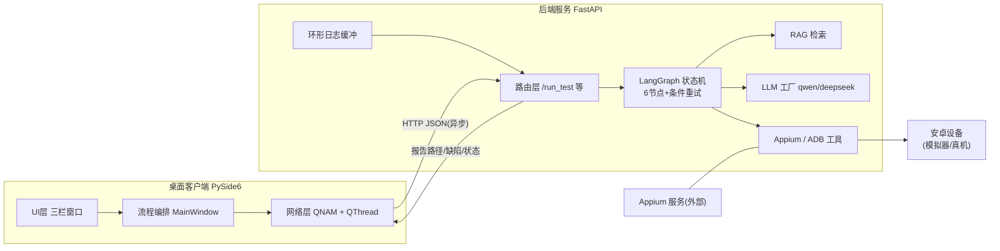
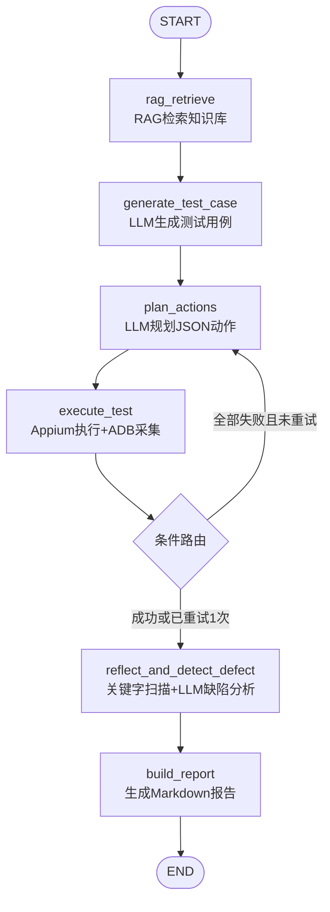
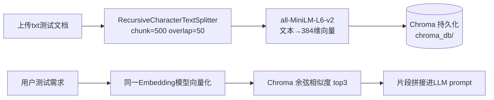
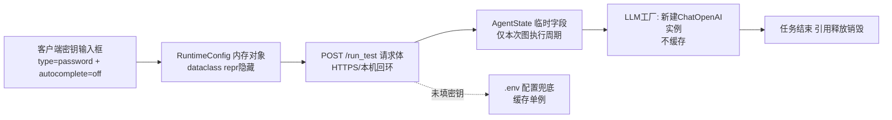

# 产物2：安卓App智能测试Agent系统——配套知识文档（知识点串联手册）

> 用途：本科毕业设计学习笔记 / 论文附录 / 面试复习
> 主线：所有知识点围绕本项目真实业务展开，说明"为什么用它、如何协同、不用别的方案的理由"。

---

## 1 系统整体架构原理

### 1.1 概念：C/S 分层架构

本项目采用 **薄客户端 + 厚后端** 的 C/S 架构：PySide6 桌面客户端（Client）只负责交互与展示；FastAPI 后端服务（Server）承载全部业务智能（Agent、RAG、Appium 调度）。



**为什么不用单体 GUI（逻辑写进 Qt 进程）？**
- 对比单体：Agent 执行分钟级，若在同进程，Python GIL 与长阻塞会拖死 UI 事件循环；进程隔离后前端崩溃不影响执行中的测试任务。
- 对比 Electron 套壳：本项目硬约束禁用 WebView——Qt 原生渲染内存占用低、启动快、无 Chromium 依赖（约省 100MB+ 体积），且打包链路简单。
- 解耦收益：后端可独立被 Web 页面（templates/index.html）、Postman、桌面端三种入口复用，符合"接口即产品"的工程思想。

### 1.2 通信原理：Qt 前端 ↔ FastAPI 后端

- **协议**：纯 HTTP + JSON。前端用 `QNetworkAccessManager`（QNAM）发起异步请求，`finished` 信号触发回调；后端 FastAPI 用 Pydantic 校验入参后调用 Agent。
- **实时日志方案**：后端把运行日志写入**内存环形缓冲**（2000 条，带全局递增 seq），客户端 `QThread` 每秒调 `GET /api/logs?after_seq=N` 增量拉取。
- **为什么用轮询而不是 WebSocket/SSE**：轮询实现 30 行、无连接状态管理、PyInstaller 打包零额外依赖；SSE/WebSocket 在 uvicorn+PyInstaller 组合下有已知兼容坑，且演示场景 1s 延迟完全可接受。这是"工程性价比"选型。
- **本项目落地**：`run_test` 是长请求（分钟级），前端 QNAM 异步等待 + 轮询线程并行补日志流，用户全程看到节点级进度（RAG检索→生成用例→…→报告）。

### 1.3 线程模型：UI 线程与业务隔离

| 线程 | 归属 | 职责 | 禁止事项 |
|---|---|---|---|
| 主线程（GUI 事件循环） | 客户端 | 绘制、信号槽分发、控件更新 | **严禁**任何网络/磁盘长阻塞 |
| QNAM 回调（主线程触发） | 客户端 | 处理请求-响应结果 | 只做轻量 UI 更新 |
| StatusMonitor(QThread) | 客户端 | 1s 轮询日志/解析节点进度 | 不直接触碰控件（走信号） |
| uvicorn 工作线程 | 后端 | 执行 Agent 全流程（含 LLM、Appium） | — |

**为什么大模型调用/Agent 执行绝不能放 UI 主线程？** Qt 事件循环单线程驱动：一旦主线程被 `run_test`（分钟级 HTTP）阻塞，`repaint` 事件无法处理，Windows 判定程序"未响应"直接白屏。本项目两条异步通道分工：**请求-响应用 QNAM**（回调天然在主线程，改 UI 免加锁）；**持续轮询用 QThread**（while 循环贴合，结果经 `Signal` 跨线程排队回主线程）。Qt 信号槽的 `QueuedConnection` 保证槽函数永远在接收者线程执行——这是跨线程安全更新 UI 的根本机制。

---

## 2 LangGraph 智能Agent核心原理

### 2.1 概念：把工作流建模为"状态图"

LangGraph 的核心抽象是 **StateGraph**：节点（Python 函数）读写共享状态（TypedDict），边定义流转，条件边实现分支与重试。



**为什么用 LangGraph 而不是裸调 LLM API？**
- 对比裸调：测试流程天然是"有状态、可分支、需重试"的多步工作流，裸调需要手写状态机与重试循环；LangGraph 用声明式图结构表达，重试逻辑就是一条条件边，**代码即流程图**。
- 对比 LangChain Chain：Chain 是线性流水线，表达不了"执行失败回退到规划节点"这类循环；LangGraph 天生支持环。
- 对比 AutoGen 等多智能体框架：本项目是**固定业务流程**而非开放式对话协作，状态图比自由对话可控、可测、可调试——毕业设计需要确定性。

### 2.2 状态流转与记忆管理

- `AgentState`（TypedDict）承载全流程数据：需求、RAG上下文、用例、动作列表、执行结果、日志、缺陷、报告路径、重试计数、临时密钥。每个节点返回部分更新字典，框架自动合并进状态。
- **短期记忆 = 状态本身**：6 节点共享同一状态，前一节点的输出即后一节点的输入，任务结束状态随请求销毁（临时密钥同步销毁，见第8节）。
- **为什么用 TypedDict 而不是 Pydantic Model**：状态是图内部契约，TypedDict 零运行时开销且 LangGraph 原生支持；Pydantic 校验留给系统边界（HTTP 层），各司其职。

### 2.3 任务规划与工具调用

- 规划：节点3 让 LLM 把测试用例翻译成 JSON 动作序列（`{"action":"click","params":{"resource_id":"..."}}`），即"LLM 出计划，代码来执行"。
- 工具调用：本项目刻意**不让 LLM 直接调工具**（非 function-calling 模式），而是"LLM 产出结构化计划 → 确定性代码执行"。
- **为什么这样设计**：测试执行要求强可重复性；LLM 直接操作工具存在幻觉点击、不可回放的问题。计划与执行分离后，动作 JSON 可存档、可人工审计、可精确重试——这是测试领域的工程化取舍。

### 2.4 大模型幻觉问题与缓解方案

| 风险 | 本项目缓解手段 | 为什么有效 |
|---|---|---|
| 生成的用例脱离测试规范 | RAG 检索 top3 真实规范片段注入 prompt | 有据可依， grounding |
| 输出 JSON 混入解释文字 | 代码块剥离 + 正则提取 + **携带解析错误重试1次** | 反馈式重试让 LLM 自修正，盲重试无效 |
| 日志分析幻觉（无中生有 Crash） | **先做关键字预扫描**（Crash/ANR/AndroidRuntime），把真实证据行随 prompt 给 LLM；宽松关键字仅对 W/E/F 级别生效 | 证据锚定；级别过滤消除 INFO 正常文本误报（实测曾误报4个"致命Crash"，修复后归零） |
| LLM 服务不可用 | 关键字证据兜底生成缺陷列表 | 系统降级可用而非瘫痪 |

---

## 3 RAG 向量检索原理

### 3.1 概念与本项目流程

RAG（Retrieval-Augmented Generation）= 检索增强生成：回答前先从知识库取相关片段，拼进 prompt。

**本项目落地链路**（把测试规范/历史缺陷文档变成 Agent 的"领域记忆"）：



- **文档切片**：RecursiveCharacterTextSplitter 按"段落→句子→字符"递归回退切分。为什么不用固定长度：会把"步骤3"和"预期结果"切到两个块，破坏语义；overlap=50 字防止关键句被切断。
- **Embedding 向量化**：all-MiniLM-L6-v2 本地推理（sentence-transformers），把文本映射为语义向量——"计算器加法怎么测"与"验证两数求和功能"字面不同、向量相近，这正是关键词检索做不到的。
- **Chroma 存储**：向量 + 原文 + 元数据持久化到 `chroma_db/`，`add_documents` 入库，`similarity_search(k=3)` 检索。
- **为什么选 all-MiniLM-L6-v2**：384 维轻量模型，CPU 毫秒级推理、离线免费、无需 API Key（对比 OpenAI text-embedding 需联网付费且密钥多一处泄漏面）；对中文虽非最优（如 bge-small-zh），但毕设知识库为可控短文本，实测检索命中准确。**选型对比**：向量库 Chroma vs FAISS vs Milvus——FAISS 只是索引库需自管持久化与元数据；Milvus 需 Docker 部署；Chroma 纯 Python 自带持久化，`pip install` 即用，演示与打包成本最低。
- **项目协同点**：`rebuild_kb` 接口支持清空 collection 按目录重灌；重建后必须复位向量库单例（Chroma collection 删除后原对象失效——实测踩坑）。

---

## 4 FastAPI 异步接口原理

### 4.1 概念：ASGI + 事件循环

FastAPI 基于 Starlette/uvicorn（ASGI），单进程事件循环处理并发 I/O；`async def` 路由内可 await，普通 `def` 路由自动丢进线程池执行——所以本项目的同步长任务 `/run_test` 不会阻塞其他接口（如轮询日志的 `/api/logs` 仍可响应）。

**为什么选 FastAPI 而不是 Flask/Django**：① Pydantic 模型即文档，自动生成 Swagger，联调效率高；② 原生异步契合"长任务+轮询"模式；③ 比 Django 轻量得多，无 ORM/Admin 等毕设用不到的重型组件。

### 4.2 Pydantic 模型：边界校验

`RunTestRequest` 用 Field 约束 `requirement` 5~2000 字符，可选字段承载前端密钥与设备覆盖。**为什么入参校验放接口层**：Agent 内部代码互信不做防御式检查（过度设计），只在系统边界校验外部输入——非法输入返回 400 + 中文逐项错误（自定义 `RequestValidationError` 处理器），而不是抛原生堆栈。

### 4.3 任务状态轮询机制

后端无 Celery（原型明确不引入任务队列），采用**同步长请求 + 日志环形缓冲轮询**：
- `run_test` 同步执行完返回完整状态摘要（报告路径/缺陷数）——响应即结果，无需任务ID查询。
- 过程可见性由 `/api/logs?after_seq=N` 增量日志 + 节点标记解析实现。
- **为什么不加 Celery/Redis**：引入消息队列=多两个常驻服务，打包分发复杂度倍增；原型单用户场景同步执行即可，工程上"够用且最简"优先。

---

## 5 Appium + ADB 移动端自动化原理

### 5.1 ADB 通信原理

ADB（Android Debug Bridge）是 PC 与安卓设备的桥梁：客户端（adb.exe）→ ADB Server（本机 5037 端口守护进程）→ adbd（设备端守护进程），三者通过 TCP/USB 通信。`adb devices` 列出序列号，`-s <serial>` 定向操作。

**本项目用法**：
- `logcat -d -t 2000`：dump 最近 2000 行日志即返回（`-d` 非流式，避免常驻读线程；`-t` 限量防内存爆）；
- `screencap -p /sdcard/x.png` + `adb pull`：截图落盘再拉取，规避部分设备 `exec-out` 二进制流被终端污染的问题；
- subprocess 统一 `timeout` 防设备假死挂死调用方。

### 5.2 Appium 自动化原理

Appium 是移动端自动化服务端：测试代码（本项目 Python 客户端）→ HTTP/W3C WebDriver 协议 → Appium Server → **UIAutomator2 驱动**（注入安卓系统的自动化代理）→ 操作 App。

- **会话（Session）**：`connect()` 携带 capabilities（platformName/deviceName/appPackage/appActivity + `appium:automationName=UiAutomator2`）创建会话，Server 自动安装并拉起 UIA2 代理与被测 App。会话是排他资源——**本项目用 try-finally 保证 quit 必达**，否则残留会话锁死设备（毕设演示现场最高频事故）。
- **元素定位**：优先 `resource-id`（唯一稳定）> accessibility-id > xpath（脆弱，仅兜底）。LLM 规划动作时在 prompt 中约定输出 resource_id，工具层只认 id——定位策略收敛保证可执行率。
- **真机/模拟器切换**：capability 动态生成（`@property`）——模拟器给 platformVersion+avd，真机注入 `appium:udid`，业务代码无感知。

### 5.3 Crash / ANR 捕获原理

- **Crash**：进程崩溃时 AndroidRuntime 打印 `FATAL EXCEPTION` 堆栈到 logcat；关键字扫描直接命中。
- **ANR**：主线程 5s 无响应（输入事件）/10s（Service）触发，logcat 出现 `ANR in <package>` + `Reason:`。
- **本项目双通道识别**：确定性关键字扫描（Crash/FATAL/ANR in/Force finishing，且按日志级别过滤——宽松关键字只对 W/E/F 生效，防止 INFO 级正常文本误报）+ LLM 语义分析（理解上下文、归纳缺陷）。为什么双通道：关键字零幻觉但不懂语义；LLM 懂语义但会编造——证据行进 prompt + 兜底降级，取长补短。

---

## 6 PySide6 桌面GUI原理

### 6.1 核心机制：信号与槽

Qt 的对象通信机制：信号（事件发生通知）与槽（响应函数）通过 `connect` 关联，跨线程自动 QueuedConnection（槽在接收者线程执行）。**本项目三处典型应用**：① `log_bridge`（logging Handler 在任意线程 emit → 主线程槽函数刷日志面板）；② StatusMonitor 线程 `logs_received` 信号携带日志列表回主线程；③ 面板间解耦（ConfigPanel 发 `start_requested` 信号，MainWindow 编排，两侧互不引用）。

**为什么选 PySide6 而不是 PyQt6/Tkinter/Electron**：PySide6 是 Qt 官方绑定（LGPL 可商用，PyQt 是 GPL/商业双协议）；Tkinter 控件贫瘠做不了三栏专业布局；Electron 违反"禁 WebView"硬约束且体积巨大。

### 6.2 主窗口与组件化

- `QMainWindow` + `QSplitter` 三栏（任务管理｜日志｜配置），各栏独立 Widget 类（TaskPanel/LogPanel/ConfigPanel），信号接口对外——**为什么组件化**：每栏可独立开发测试，改日志着色逻辑不动任务面板。
- 日志组件：QTextEdit 只读 + QTextCharFormat 按级别着色（INFO蓝/DEBUG灰/WARN橙/ERROR红），`blockCount>5000` 触发头部截断防内存增长；自动滚动开关 + 导出 txt。
- 报告预览：`QTextDocument.setMarkdown()` 原生渲染——Qt 内置 Markdown 解析器，零 WebView、零额外依赖，覆盖标题/列表/代码块/表格，满足演示级预览。
- 异常弹窗：按错误文本分类（含"Appium"→设备排查指引；含"401/API"→密钥指引），`QMessageBox` 统一入口——把后端错误翻译成用户可行动的提示。

### 6.3 客户端线程模型落地

QNAM 负责"一次请求一个回调"（启动/上传/执行任务）；QThread 负责持续轮询（`run()` 循环 + 分片睡眠 100ms 保证 `stop()` 秒级退出，`wait(3000)` 收尸）。**坑位记录**：QNAM 的 QNetworkReply 若不被 Python 引用会被 GC 立即中止——调用方必须持有返回值；multipart 上传的 QFile 生命周期需 `setParent` 挂到 reply。

---

## 7 打包发布原理

### 7.1 PyInstaller 打包原理

PyInstaller 分析入口脚本的 import 图，把**解释器 + 依赖包 + 资源**收集到输出目录（onedir），启动器 exe 引导 `sys._MEIPASS`（解压/资源根目录）。

| 决策点 | 选择 | 理由 |
|---|---|---|
| onedir vs onefile | **onedir** | onefile 每次启动解压到临时目录（torch 级依赖慢 10s+）、内存驻留整包、杀毒误报率高；onedir 启动快、稳定——演示场景稳定优先 |
| console 后端 | 保留 | 答辩现场可直接看日志排障 |
| console 客户端 | windowed | GUI 程序无控制台更专业 |

### 7.2 依赖处理三大坑（本项目实战修复）

1. **动态导入收集不全**：langgraph/uvicorn 子模块、chromadb 的 telemetry（posthog）为运行时动态 import，静态分析不到 → `--hidden-import` 18 项 + `--collect-submodules chromadb`。
2. **包元数据缺失**：appium 等库运行时读 `importlib.metadata` 版本号 → `--copy-metadata` 23 项，缺一个运行即报 PackageNotFoundError。
3. **资源路径**：打包后模板/数据目录不再是源码相对路径 → `resource_path()`（只读资源→`_MEIPASS`）与 `data_path()`（可写数据→exe 同级目录）双函数统一收口；uvicorn 启动必须传 app 实例而非 `"api.server:app"` 字符串（打包后无源码可 import）。

### 7.3 exe 体积与外部依赖说明

- 产物体积：后端目录 ~0.9GB（torch/chromadb/transformers 占大头），客户端 ~150MB（PySide6）。**为什么不做体积优化**：UPX 压缩提高杀毒误报率、onedir 已规避单文件解压，毕设演示体积不敏感、稳定敏感。
- **不能打包进程序的依赖**：Appium（Node.js 生态服务）、Android SDK/adb、模拟器——它们是独立进程与外部环境，PyInstaller 只能打包 Python 世界。因此交付形态 = "程序包 + 环境自装文档 + start_all.bat 一键脚本"，把外部启动动作脚本化收敛。

---

## 8 项目安全设计：LLM API 密钥仅内存存储

### 8.1 威胁模型

密钥泄漏面：源码硬编码、配置文件、日志、缓存、数据库、浏览器自动填充。本项目目标：**用户在界面输入的密钥不落任何盘**。

### 8.2 全链路设计



关键实现与约束：
- 客户端 `RuntimeConfig`：密钥字段 `field(repr=False)`，持久化函数只写 `api_base_url/llm_provider` 两个非敏感项；
- 后端 `_mask_key`：日志只打前 4 位（`sk-t***`）；`/api/last_result` 缓存**剥离**密钥字段；
- LangGraph 状态中的密钥字段随任务结束销毁，不写 .env/json/数据库；
- Web 端输入框 `type="password"` + `autocomplete="off"`，浏览器不保存、刷新即失。
- **为什么保留 .env 兜底**：固定演示环境免每次输入；两种方式兼容（前端密钥优先级更高），符合"安全默认 + 便捷可选"原则。
- **验证手段**：以假密钥跑全链路后 grep 全部输出目录/env/日志文件，确认零残留——安全设计必须可验证。

---

## 9 项目难点、问题与解决方案（面试高频）

### 难点1：大模型输出 JSON 不合规导致动作解析失败
- **现象**：plan_actions 节点频繁 `JSONDecodeError`，输出被 ```json 代码块包裹或夹带解说文字。
- **原因**：LLM 按概率生成文本，不保证严格 JSON；temperature>0 更加剧。
- **解决**：多策略解析（剥离 markdown 代码块 → 正则提取 `[...]` 数组 → json.loads）+ 失败后**携带具体解析错误重试1次**。
- **为什么这么做**：盲重试输入不变输出大概率不变；把解析错误反馈进 prompt 构成闭环，实测大幅提升合格率。工程上"重试要带信息"是通用原则。

### 难点2：缺陷检测误报——正常日志被判为致命 Crash
- **现象**：一次全绿的执行被报 4 个"致命 Crash"。
- **原因**：关键字匹配不分日志级别，INFO 级文本里出现 "crash" 字样即误中。
- **解决**：关键字扫描增加级别过滤（宽松关键字仅对 W/E/F 生效），并为 LLM 提供**真实证据行**锚定。
- **为什么**：误报比漏报更伤系统公信力；"确定性证据优先、LLM 语义辅助、证据兜底"三层防线让纯 LLM 幻觉无处遁形。

### 难点3：GUI 卡死与线程安全
- **现象**：初版直接在按钮回调里 requests.post 调 /run_test，界面"未响应"。
- **原因**：分钟级同步 HTTP 阻塞 Qt 事件循环，重绘事件饿死。
- **解决**：请求-响应走 QNAM 异步；持续轮询走 QThread+信号；日志跨线程经 Signal 排队回主线程。
- **为什么**：Qt 单线程 UI 模型决定了"主线程只做轻活"；QNAM 回调天然在主线程触发，改 UI 无需加锁，是比"子线程请求+信号回传"更简洁的标准解。

### 难点4：PyInstaller 打包后 ModuleNotFoundError（unicodedata）
- **现象**：开发环境正常，exe 启动即崩 `No module named 'unicodedata'`。
- **原因**：构建环境权限受限，PyInstaller 读不到系统 Python 的 C 扩展（.pyd），stdlib 收集不完整。
- **解决**：在干净权限环境重新构建；配合 hidden-import/copy-metadata/collect-submodules 三板斧。
- **为什么**：PyInstaller 静态分析有盲区，正确方法论是"以运行时报错为信号逐个补齐"，而不是一次性猜全清单；构建环境权限问题是隐性变量，验证标准必须是"目标机器实际运行"。

### 难点5：Appium 会话泄漏锁死设备
- **现象**：多次失败重试后设备假死，重启模拟器才恢复。
- **原因**：异常路径未 quit，残留 session 持有设备。
- **解决**：execute_test 节点 try-finally 强制 close；connect 失败清理半初始化 driver。
- **为什么**：外部资源（设备/会话）的释放必须用"必然执行"的结构保证，不能依赖每条异常分支自觉——finally 是唯一可靠写法。

### 难点6：长任务过程不可见，用户以为程序挂了
- **现象**：/run_test 分钟级无任何反馈。
- **原因**：同步接口只有终态响应。
- **解决**：后端环形日志缓冲 + `/api/logs` 增量拉取；客户端轮询解析"节点N"标记驱动进度条（16%→33%→…→95%→100%）。
- **为什么**：不加任务队列即可获得"伪流式"体验；按节点映射进度让 LLM 工作流对用户透明，是低成本高感知的体验设计。

### 难点7：双 LLM 与真机/模拟器切换的配置爆炸
- **现象**：capability、base_url、model 在多处 if-else 散落。
- **解决**：settings 用 `@property` 动态派生（ANDROID_CAP/active_llm_*），前端覆盖值通过状态注入，.env 兜底。
- **为什么**：把"模式切换"收敛为数据问题（读哪套配置）而非控制流问题，新增 provider 只加一个分支函数，符合开闭原则。

### 难点8：密钥安全与便捷性的平衡
- （详见第8节）前端输入内存即焚 + .env 兜底双轨制；全链路脱敏 + 缓存剥离 + grep 验证，安全设计形成闭环证据链。

---

## 附：技术选型对照总表

| 层 | 选型 | 落选方案 | 一句话理由 |
|---|---|---|---|
| Agent 编排 | LangGraph | 裸LLM/Chain/多智能体 | 固定流程需要状态图+条件重试 |
| 向量库 | Chroma | FAISS/Milvus | pip即用+持久化，零部署 |
| Embedding | all-MiniLM-L6-v2 本地 | OpenAI embedding | 离线免费无密钥面 |
| 后端 | FastAPI | Flask/Django | Pydantic校验+异步+自动文档 |
| 桌面 | PySide6 | PyQt6/Tkinter/Electron | 官方LGPL/控件丰富/禁WebView |
| 异步网络 | QNAM + QThread | requests同步/asyncio | 回调主线程免锁+轮询贴合 |
| 打包 | PyInstaller onedir | onefile/Nuitka | 启动快误报低；Nuitka编译链过重 |
| 实时日志 | 环形缓冲+HTTP轮询 | WebSocket/SSE | 打包零坑，演示够实时 |
