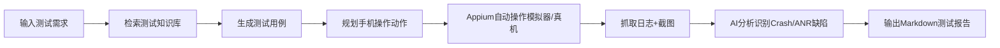
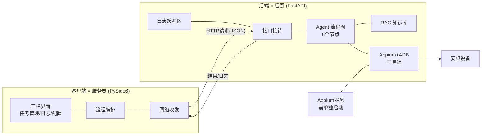
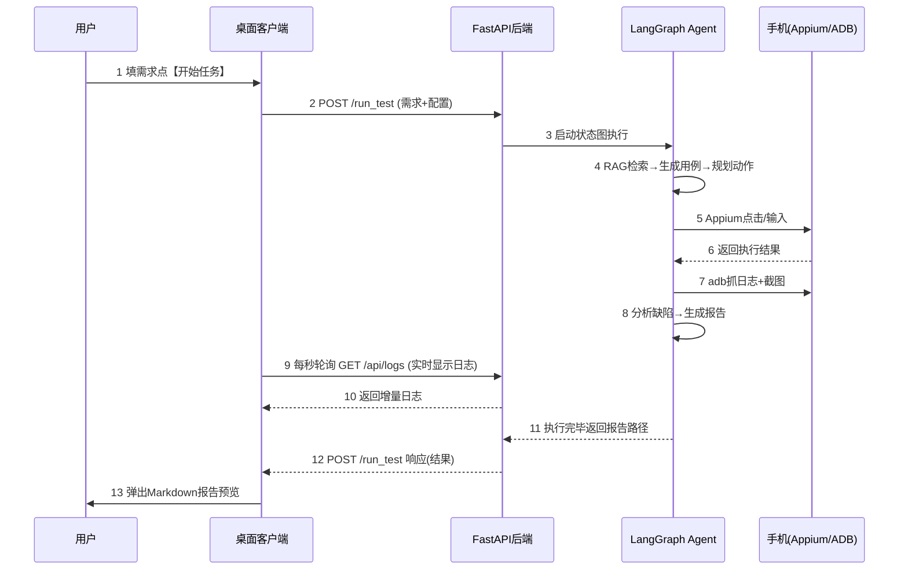
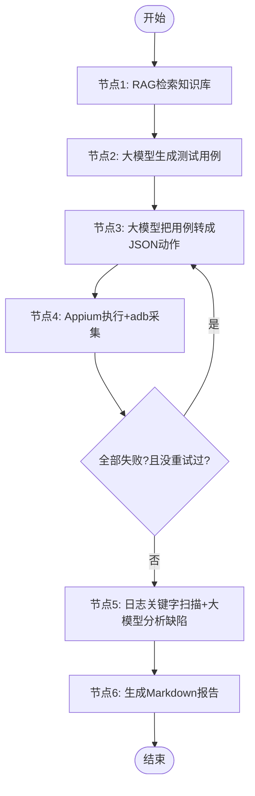

# 从零学会 AI Agent 开发：用"安卓App智能测试Agent"实战教学

> **序言：知识主动分享**
> 这份文稿来自一个真实可运行的毕业设计项目——安卓App智能测试Agent系统。我们相信最好的学习方式，不是背概念，而是跟着一个"能跑、能用、能演示"的真实项目，把每一层拆开看明白。文中所有架构、文件、接口都来自项目实物，读完你不仅能看懂这一个项目，更能带走一套"企业级分层开发"的通用思路。欢迎转发、分享、二次创作。

---

# 第一章：课程介绍 & 项目简介

## 1.1 什么是 AI Agent？——先讲个比喻

想象你招了一位**很聪明的实习生**：

- 你对他说："帮我测一下这个计算器 App 的加法功能。"
- 他不是傻等着你下指令，而是**自己拆解任务**：查一下公司测试规范 → 写出测试用例 → 打开手机一个一个点 → 盯着日志看有没有崩溃 → 最后交给你一份测试报告。

**Agent（智能体）就是这样的"实习生"**：大模型（LLM）是他的大脑，各种工具（Appium、ADB）是他的双手，而"先思考哪一步、再执行哪一步"的工作流程，需要我们用代码给他规划好。

一句话对比：

- **普通大模型调用**：你问一句，他答一句，答完就完了（只是大脑）。
- **Agent**：大脑 + 计划 + 工具 + 循环检查，能**自主完成一整件事**（大脑+双手+工作流程）。

## 1.2 我们这个项目是做什么的？解决什么痛点

**痛点**：安卓 App 测试很费人工——测试同学要自己写用例、在手机上一步步点、翻看几百行日志找崩溃、手工写报告。重复、枯燥、容易漏。

**本项目做了什么**：一个 Windows 桌面软件。你输入一句"测试计算器的加法功能"，点一下按钮，AI Agent 自动完成：



全程几分钟，人只做一件事：**看报告**。

## 1.3 为什么选这个项目做 Agent 教学案例？

因为它**麻雀虽小五脏俱全**，一个项目串起了企业 AI 应用的全部关键环节：

| 关键环节 | 在本项目中的体现 |
|---|---|
| 大模型接入 | 通义千问 / DeepSeek 双模型，OpenAI 兼容接口 |
| RAG 知识库 | 测试规范文档入库，检索后喂给大模型 |
| 工具调用 | Appium 操控手机、ADB 抓日志截图 |
| 流程编排 | LangGraph 状态图，6 个节点 + 失败自动重试 |
| 桌面软件 | PySide6 原生 GUI（不是网页套壳） |
| 工程化收尾 | 异常处理、日志、打包 exe、分发 |

学完它，你把"手机测试"换成"运维巡检""文档审批"，架构思路一模一样。

## 1.4 整体技术栈一览（每个都是"谁在干什么"）

| 技术 | 通俗解释 | 在项目里的角色 | 为什么选它 |
|---|---|---|---|
| Python | 胶水语言，AI 生态最全 | 全项目的开发语言 | AI 库最多，招人最好招 |
| FastAPI | 一个"前台接待"框架，帮你把函数变成网络接口 | 后端服务，接收客户端请求 | 自带参数校验和接口文档，写错参数会友好提示 |
| LangGraph | "工作流程编排器"，把多步骤任务画成一张流程图 | 编排 Agent 的 6 个工作节点 | 支持分支和重试，比手写循环清晰 |
| LangChain | 大模型的"万能转接头" | 统一接入不同厂商的大模型 | 换模型不用改业务代码 |
| Chroma | 一个"能按意思搜索"的本地数据库 | 存测试知识文档的向量 | pip 一装就能用，不用装数据库软件 |
| Embedding 模型 | 把文字变成"数字坐标"，意思近的文字坐标也近 | 文档和需求文本转向量 | 本地运行，免费、不联网 |
| RAG | 先查资料再回答（检索增强生成） | 让大模型按公司测试规范出用例 | 大幅减少大模型"一本正经胡说八道" |
| Appium | 手机自动化"机械手" | 模拟人的点击、输入 | 跨真机和模拟器，行业标准 |
| ADB | 电脑和安卓手机之间的"对讲机" | 抓手机日志、截屏 | 安卓官方工具，稳定 |
| PySide6 | 用 Python 写桌面软件的官方库 | 整个图形界面 | Qt 官方出品，控件专业，不嵌浏览器 |
| PyInstaller | 把 Python 项目"压缩成 exe" | 打包发布 | 对方电脑不用装 Python |

## 1.5 企业级开发和网上简单 demo 的区别（重点！）

网上 demo 常见样子：一个 `main.py` 五百行，从调模型到操作手机全糊在一起。**能跑，但不能活**。

| 维度 | 网上 demo | 企业级做法（本项目） |
|---|---|---|
| 文件组织 | 全塞一个文件 | 按职责分文件夹（config/utils/agent/tools…） |
| 换个大模型 | 全文搜索改代码 | 改一行 `.env` 配置 |
| 排查 bug | print 大法翻半天 | 统一日志，每一步有记录可查 |
| 出错了 | 白屏崩溃 | 分类捕获，用户看到"人话"提示 |
| 交付 | "你先装下 Python…" | 双击 exe 就能跑 |

**核心思想一句话：分层解耦——每块代码只干一件事，块与块之间用明确定义的"接口"对话。** 后面每一章你都会看到这条原则反复出现。

---

# 第二章：系统整体架构通俗讲解（C/S 架构）

## 2.1 架构图：一家"餐厅"的分工

C/S 架构 = Client/Server（客户端/服务端）。把本项目想象成一家餐厅：

- **桌面客户端（PySide6）= 服务员**：长得好看、跟你互动（点菜、上菜、汇报进度），但**不做菜**。
- **FastAPI 后端 = 后厨**：客人看不见，但所有真正的活儿（做菜=跑 Agent、操作手机）都在这里干。



**职责划分（背下来）**：

- 客户端只做三件事：**收集配置、展示日志和进度、预览报告**。
- 后端做所有"动脑子+动手"的事：**查知识库、调大模型、规划动作、操作手机、分析缺陷、生成报告**。

## 2.2 为什么拆分前后端？全写一起会怎样？（小白重点）

假设我们把 GUI 和 Agent 逻辑全写进一个程序，会发生什么？

1. **界面卡死**：Agent 跑一次要几分钟，这段时间界面完全冻住，Windows 直接提示"未响应"。原因见 5.5 节。
2. **牵一发动全身**：改个日志颜色，可能把测试执行改崩，因为代码全搅在一起。
3. **没法分工**：一个人改界面必须看懂全部手机测试逻辑。
4. **没法复用**：想加个网页版入口？对不起，逻辑长在界面代码里，拔不出来。

**企业为什么强制分层**——因为分层后：

- 客户端崩了，后端还在跑，任务不丢；
- 想加个网页入口（本项目真加了 `templates/index.html`），后端一行不用改；
- 每个文件夹职责单一，新同事半天能看懂结构。

> 记住这个比喻：**服务员不进后厨，后厨不端盘子。中间靠"下单小票"（HTTP 接口）传话。**

## 2.3 数据完整流转链路：一次点击的奇幻漂流

用户点下【开始任务】按钮后，数据是这样流的：



注意第 9 步：**任务执行期间，客户端每隔 1 秒问一次后端"有什么新日志"**——这就是"轮询"，让用户实时看到 Agent 在干什么，而不是干等几分钟面对一个转圈圈。

---

# 第三章：项目目录 & 所有文件逐份讲解（核心章节）

先看全貌，再逐个讲。**建议对照真实项目边看边翻文件。**

```
test_agent/
├── main.py                  # 后端总开关
├── requirements.txt         # 采购清单（依赖列表）
├── .env                     # 私密账本（密钥配置，不进git）
├── .env.example             # 账本模板（给大家看格式的）
├── .gitignore               # "这些文件别上传"清单
├── README.md                # 说明书
├── build_exe.py             # 后端打包脚本
├── config/
│   └── settings.py          # 全项目"设置中心"
├── utils/                   # 公共工具箱
│   ├── logger.py            # 记日志的
│   ├── log_buffer.py        # 日志临时存放区
│   └── resource_path.py     # 找文件的（打包后也能找对）
├── rag/                     # 知识库模块
│   ├── document_loader.py   # 读文档+切片
│   └── vector_store.py      # 向量仓库
├── tools/                   # Agent 的"手"
│   ├── appium_tool.py       # 操作手机
│   ├── adb_tool.py          # 抓日志截图
│   └── report_tool.py       # 写报告
├── agent/                   # Agent 的"大脑流程"
│   ├── state.py             # 工作交接单
│   ├── nodes.py             # 6个工位的具体操作
│   └── graph.py             # 流水线装配图
├── api/
│   └── server.py            # 所有对外接口
├── templates/
│   └── index.html           # 网页版入口（备用演示）
├── desktop/                 # 桌面客户端（独立前端工程）
│   ├── main.py              # 客户端总开关
│   ├── core/                # 客户端底层（配置/日志桥/图标）
│   ├── net/                 # 客户端网络层
│   └── ui/                  # 客户端界面层
├── packaging/               # 分发物料（一键启动脚本+说明）
└── outputs/                 # 运行产物（报告/截图/日志）
```

## 3.1 根目录文件

| 文件 | 干什么的 | 为什么单独建 | 重点看什么 |
|---|---|---|---|
| `main.py` | 启动后端服务的入口 | 入口独立，一条命令起服务 | `uvicorn.run(app, ...)` 传的是 app 对象本身——打包后传字符串会崩（企业级细节！） |
| `requirements.txt` | 列出所有第三方依赖 | 别人拿到项目一条命令装齐环境 | 留意版本号下限写法 |
| `.env` / `.env.example` | 存 API 密钥等私密配置 | **密钥绝不写死在代码里**，example 是给别人看的模板 | 密钥管理思想，企业安全第一课 |
| `.gitignore` | 告诉 git 哪些文件不上传 | `.env`（密钥）、`outputs/`（产物）都不该进仓库 | 安全意识 |

## 3.2 config/ ——设置中心

- **`settings.py`**：全项目的"设置中心"，用 pydantic 的 BaseSettings 把大模型地址、密钥、手机参数、路径全部集中管理，**自动读取 `.env` 文件**。
  - 为什么单独建：配置散落在代码各处 = "改一处崩三处"。集中后，换模型只需改配置文件，不用动代码。
  - 小白重点：`ANDROID_CAP` 这个属性（@property 装饰的函数）——它根据"真机还是模拟器"的开关**动态生成**手机连接参数。这是"配置驱动行为"的教科书示例。

## 3.3 utils/ ——公共工具箱（谁都能用，但不掺业务）

- **`logger.py`**：统一日志。整个项目所有模块打日志都用它，格式统一。**为什么**：排查线上问题全靠日志，格式混乱的日志等于没日志。
- **`log_buffer.py`**：一个内存里的"环形缓冲区"（存最近 2000 条日志，满了自动丢最旧的）。**为什么**：桌面客户端要实时拉日志显示，这个缓冲区就是数据源。
- **`resource_path.py`**：一个找文件路径的小函数。**为什么单独建**：程序打包成 exe 后，文件路径和开发时不一样（变成 `_MEIPASS` 临时目录），所有读模板、写报告的地方都必须用它，否则打包后全崩。**这是打包踩坑的头号经验。**

> **为什么要分出 utils/**：工具代码没有业务含义（日志、路径、缓冲），但谁都要用。单独归类 = 复用 + 不污染业务代码。

## 3.4 rag/ ——给大模型配个"资料室"

- **`document_loader.py`**：读入 txt 文档，切成小片段（每片约500字）。**为什么要切片**：大模型上下文有限，而且整篇塞进去它抓不住重点，切片后按需取用。
- **`vector_store.py`**：向量仓库。文档片段 → 向量化 → 存入 Chroma；查询时按"语义相似度"返回最相关的 top3 片段。**为什么单例模式**：embedding 模型加载要十几秒，全项目共用一份，不能每次查询都重新加载。

## 3.5 tools/ ——Agent 的"手"

| 文件 | 干什么 | 企业级细节 |
|---|---|---|
| `appium_tool.py` | 封装"连接手机、点击、输入、关闭" | 异常分 6 类捕获（连不上/找不到元素/超时…），每类给不同的人话提示；`try-finally` 保证会话一定关闭，否则设备被"锁死" |
| `adb_tool.py` | 调 adb 命令抓日志、截屏 | subprocess 全部带超时，防设备假死拖垮程序 |
| `report_tool.py` | 拼装 Markdown 报告 | 时间戳命名，目录不存在自动创建 |

> **为什么工具单独成层**：Agent 节点只负责"决定做什么"，具体"怎么做"全在 tools 层。将来换成 iOS 测试，只改 tools 层，Agent 逻辑一行不动。**这叫依赖倒置，企业架构的命根子。**

## 3.6 agent/ ——大脑流程（本项目灵魂）

- **`state.py`**：定义 AgentState——一张"工作交接单"，列出全流程要传递的所有信息（需求、用例、动作、结果、日志、缺陷、报告路径、重试次数…）。**为什么先定义它**：状态是节点之间的"合同"，先签合同再干活，节点之间才不打架。
- **`nodes.py`**：6 个节点函数，每个只做一件事：检索→生成用例→规划动作→执行→分析缺陷→出报告。里面还有个 **LLM 工厂函数**：根据配置造出对应的大模型客户端，支持"前端临时填的密钥"（用完即弃）和".env 配置的密钥"两种来源。
- **`graph.py`**：把 6 个节点按顺序装配成流水线，并加了一条**条件边**：执行全失败且没重试过 → 退回"规划动作"节点重来一次。**为什么用图不用 if-else**：重试逻辑写进图里，清清楚楚看得见，而不是埋在函数嵌套里。

## 3.7 api/ 与 templates/

- **`server.py`**：后端所有对外接口都在这（下一章详讲）。**为什么集中放**：接口是系统的"门面"，集中管理一眼看清系统对外提供什么能力。
- **`index.html`**：一个纯 HTML+JS 的网页操作页。**为什么有它**：答辩/演示时万一桌面客户端出问题，浏览器打开就能用——**后端能力不绑死在任何一个前端上**，这就是分层解耦的红利。

## 3.8 desktop/ ——桌面客户端（一个独立小工程）

注意它内部又分了三层，**和后端一个思想**：

```
desktop/
├── core/        # 底层：config.py(配置，密钥只在内存) / app_log.py(日志→界面信号桥) / icon_maker.py(代码画图标)
├── net/         # 网络：http_client.py(发请求) / api_service.py(接口封装) / status_worker.py(轮询线程)
└── ui/          # 界面：main_window.py(主窗口三栏) / left_panel.py(任务) / center_panel.py(日志) / right_panel.py(配置) / dialogs.py(弹窗+报告预览)
```

- **为什么 core/net/ui 分三层**：底层不知道界面长啥样，界面不关心网络怎么发——每一层都能独立修改测试。
- **`status_worker.py` 单独讲**：这是一个 QThread 线程类，每秒向后端要一次新日志。**为什么单独一个文件一个线程**：见 5.5 节，UI 线程绝不能干等。
- **小白重点看**：`main_window.py` 里的**信号连接**（.connect 那些行）——它是整个客户端的"神经接线图"。

## 3.9 packaging/ 与 outputs/

- `packaging/`：一键启动脚本 `start_all.bat`（按顺序拉起 Appium→后端→客户端）和给使用者的说明文档。**为什么**：软件要发给别人，对方环境不同，脚本+文档把门槛降到最低。
- `outputs/`：运行时产生的报告、截图、日志。**为什么和代码分开且不进 git**：代码是"资产"，运行产物是"垃圾"（应该被管理但不该进版本库）。

---

# 第四章：接口设计讲解（小白友好）

## 4.1 什么是 API 接口？

继续餐厅比喻：**API 接口 = 点菜窗口**。你（客户端）递上一张写好的单子（请求），窗口按规矩给你回一样东西（响应）。规矩包括：

- **地址**（去哪个窗口）：如 `http://127.0.0.1:8000/run_test`
- **方法**（做什么类型的事）：GET=问问看（只读）、POST=办件事（可能有副作用）
- **参数**（单子上写什么）：JSON 格式的数据
- **返回**（给你什么）：也是 JSON

**127.0.0.1:8000 是什么**：127.0.0.1 指"本机自己"，8000 是门牌号（端口）。客户端和后端都跑在你电脑上，所以是本机通信。

## 4.2 后端接口清单（全部家底）

| 接口 | 方法 | 作用 | 传入 | 返回 |
|---|---|---|---|---|
| `/health` | GET | 健康检查（服务活着吗） | 无 | `{"status":"ok"}` |
| `/upload_doc` | POST | 上传txt知识文档入库 | 文件（multipart） | 文件名+切了多少片段 |
| `/run_test` | POST | **启动Agent测试任务**（核心） | requirement需求文本 + 可选：模型provider、两个API密钥、设备模式、真机UDID | 报告路径、缺陷列表、错误信息 |
| `/api/config` | GET | 查当前后端配置 | 无 | 当前模型/设备/包名 |
| `/api/logs` | GET | 增量拉取日志 | after_seq=已看过的最大序号 | 新日志列表+最新序号 |
| `/rebuild_kb` | POST | 重建向量库 | 无 | 入库片段数 |
| `/api/last_result` | GET | 查最近一次任务结果 | 无 | 用例+日志摘录 |

**注意 `/run_test` 的密钥参数**：客户端可以现场填密钥随请求传过来，后端**只在内存里用这一次，不写任何文件**——这是安全设计（第 7.2、8 章还会讲）。

## 4.3 前后端怎么通信？轮询是什么？

Qt 客户端发 HTTP 请求用的是 `QNetworkAccessManager`（Qt 自带的网络收发器）。它的特点是**异步**：发出去之后不等结果，结果回来时通过"信号"通知界面更新——期间用户该干嘛干嘛。

**轮询（Polling）**——最直白的理解：

> 你在网上买东西后，每隔 1 分钟刷新一次页面看物流。客户端的 `status_worker.py` 线程就是每秒"刷新一次"，调用 `/api/logs?after_seq=N`，`after_seq` 就是"我上次看到第几条了"，后端只返回**新于这条**的日志。这样不重复、不遗漏。

**为什么用轮询不用 WebSocket（长连接推送）**：轮询实现简单、打包不容易出幺蛾子，演示场景 1 秒延迟无感。企业里两种都会用——**选型看场景，不追时髦**。

## 4.4 企业接口设计小规范（本项目全做到了）

1. **命名见名知义**：`/run_test` 一看就知道干嘛，动词_宾语。
2. **参数校验前置**：用 Pydantic 模型定义参数规则（如需求文本必须 5~2000 字），不合法直接拒绝，**垃圾进不来**。
3. **错误说人话**：参数错了返回"需求描述至少5个字符"，而不是甩一屏英文堆栈。本项目专门注册了校验错误处理器来翻译错误。
4. **职责单一**：一个接口只干一件事；查配置和跑任务绝不混在一个接口里。

---

# 第五章：核心模块分步讲解（由浅入深）

## 5.1 FastAPI 后端基础：路由、数据模型、长任务

**路由**就是"哪个网址交给哪个函数处理"：

```python
@app.post("/run_test")
async def run_test(request: RunTestRequest):   # 参数自动校验
    final_state = run_test_agent(request.requirement, ...)  # 调Agent
    return build_response(final_state)
```

**Pydantic 数据模型**：定义"单子上能写什么"的规则表。

```python
class RunTestRequest(BaseModel):
    requirement: str = Field(..., min_length=5, max_length=2000)  # 需求必须5~2000字
    qwen_api_key: Optional[str] = None    # 密钥可不填
```

不填必填项、长度不对，FastAPI **自动拒绝**，代码里一行判断都不用写。这就是"框架替你把关"。

**长任务怎么办**：`/run_test` 一跑几分钟，本项目选择"同步执行 + 日志轮询补实时性"。企业更大规模会用 Celery 任务队列，但原型阶段**不引入重装备，够用就好**——这也是工程判断力。

## 5.2 LangGraph Agent：一张会自动流转的流程图

回顾第 2 章的比喻：Agent 是实习生，LangGraph 就是**给实习生定的标准作业流程（SOP）**。三个核心概念：

- **State（状态）**：工作交接单，全流程共享。
- **Node（节点）**：一个工位，接收交接单→干活→把结果写回交接单。
- **Edge（边）**：工位之间的流转路线，包括**条件边**——"上一工位失败了，退回重做"。



**"工具调用"通俗版**：大模型不直接摸手机！它只输出一张"操作清单"（JSON，如"点击 resource_id 为 com.miui.calculator 的按钮"），由**确定的代码**（tools 层）去执行。

> **为什么不让大模型直接操作？** 大模型会"幻觉"（胡来），操作清单可审查、可重放、可归档。**大脑出主意，双手按章程办事**——这是测试场景对"可重复性"的硬要求。

**状态里有个巧妙设计**：`plan_retry_count` 字段记录重试次数，条件边读它决定走向——**重试逻辑变成了看得见的数据，而不是藏起来的循环**。

## 5.3 RAG：给大模型开卷考试

**问题**：大模型训练数据有截止日期，也不了解"你们公司的测试规范"，硬问它就会瞎编（**幻觉**）。

**RAG 的思路**：让它**开卷考试**——回答前先把相关资料查出来放在考卷上。

四步流程（对应 `rag/` 两个文件）：

1. **切**（document_loader）：文档切成 500 字左右的小片段；
2. **化**：每个片段用 Embedding 模型变成一串数字（向量）——意思相近的文字，向量也相近（想象给每段话一个"语义坐标"）；
3. **存**（vector_store）：向量+原文存进 Chroma；
4. **查**：用户需求也变成坐标，找坐标最近的 top3 片段，塞进大模型的提示词里。

**为什么这能降幻觉**：大模型的回答被"锚定"在真实资料上，有据可依。本项目实测：不检索时生成的用例天马行空，检索后贴合规范。

## 5.4 Appium + ADB：Agent 的双手和眼睛

**ADB**（电脑↔手机的桥）：本项目用它抓日志（`logcat`，手机的各种运行记录）和截屏（`screencap`）。类比：手机的"行车记录仪读取器"。

**Appium**（自动机械手）：你告诉它"点击哪个元素"，它模拟人的手指去点。核心概念：

- **会话（Session）**：一次"接管手机"的租约，用完必须还（quit），否则手机被锁住，别人连不上——**本项目用 try-finally 保证一定会还**。
- **元素定位**：页面上每个控件有"身份证号"（resource_id），按 id 定位最稳，比"点坐标"靠谱得多。
- **capabilities**：连接参数清单（哪个设备、开哪个App、用什么驱动），本项目在 settings 里**根据真机/模拟器开关动态生成**。

**缺陷识别双保险**（节点5）：先用**关键字扫描**（Crash/FATAL/ANR 这些死亡标志，且只看警告以上级别的日志，防误报），再把**真实证据行**交给大模型做语义分析。**为什么双保险**：关键字不撒谎但看不懂上下文；大模型看得懂但会编——证据给它，让它的分析"有据可查"；大模型挂了，关键字兜底照样出缺陷报告。

## 5.5 PySide6 桌面 GUI：为什么不能在主线程干重活？（本章最重要）

**Qt 程序的heartbeat**：界面靠一个"事件循环"活着——不停地处理"点按钮、刷新画面"这些事件，循环转得顺滑，界面就流畅。

**灾难现场**：如果你在按钮的响应函数里直接写"调后端跑 Agent（耗时3分钟）"——事件循环被卡住 3 分钟，期间**画面不刷新、按钮点不动**，Windows 判定"未响应"。

> 比喻：餐厅只有一个服务员（主线程）。他跑去后厨盯着菜炒了 3 分钟，大厅所有客人没人管——**点餐的不能去炒菜，得叫后厨（子线程）干，干完端出来**。

本项目三条纪律：

1. **发请求用异步**（QNetworkAccessManager）：发出后立即返回，结果到了通过信号通知界面；
2. **持续轮询开子线程**（QThread）：`status_worker.py` 专职每秒要日志；
3. **子线程不许直接碰界面**：通过**信号（Signal）**把数据"寄"回主线程处理——Qt 保证信号处理永远在主线程执行，天然线程安全。

**信号槽一句话**：信号="广播喇叭"，槽="听见广播来干活的人"，`connect` 是接线。子线程 emit 信号 → 主线程的槽函数自动被叫来处理。整个客户端的"神经接线图"就在 `main_window.py` 的 `_connect_signals` 里。

---

# 第六章：从零搭建项目，小白学习顺序（按部就班路线）

> **核心忠告：不要一上来就写 Agent！** 串行学习，每一步都做出"能验证的小东西"，攒信心也攒地基。

### 第 1 步：搭环境、装依赖
- **目标**：项目能在本机 `python main.py` 跑起来。
- **做**：装 Python 3.10+，`pip install -r requirements.txt`，建虚拟环境。
- **为什么先做**：环境是地基，后续每一步的验证都靠"能跑起来"。
- **能验证**：`import fastapi, langgraph, chromadb` 不报错。
- **常见坑**：Python 版本太老；国内网络慢换清华源；embedding 模型第一次要联网下载。

### 第 2 步：FastAPI 骨架 + 第一个接口
- **做**：写 `main.py` + 一个 `/health` 接口，浏览器打开 Swagger 文档页玩一玩。
- **为什么**：先打通"HTTP 进出"，后面所有接口都是复制这个模式。
- **能验证**：浏览器访问 `/health` 返回 ok。
- **坑**：端口被占（换端口或杀进程）；改完代码没重启服务。

### 第 3 步：Appium 封装，手机点起来
- **做**：装 Node.js → `npm install -g appium` → 启动模拟器 → 写 `appium_tool.py`，实现"连接+点一下计算器"。
- **为什么**：先让"手"能动，Agent 后面才有工具可用。
- **能验证**：看见模拟器里的 App 被程序自动点开。
- **坑**：会话忘了 quit 导致设备锁死；capability 参数名写错（W3C 规范要加 `appium:` 前缀）。

### 第 4 步：RAG 模块，文档查得动
- **做**：写 `document_loader.py` 和 `vector_store.py`，上传一篇测试规范，检索"加法怎么测"。
- **为什么**：先验证"知识库检索"这个零件是好的，再装进 Agent。
- **能验证**：返回的 top3 片段确实相关。
- **坑**：忘加单例导致每次检索都等十几秒加载模型。

### 第 5 步：LangGraph Agent，串成流水线
- **做**：写 `state.py`（先定合同）→ `nodes.py`（6 个工位）→ `graph.py`（装配+条件重试）。
- **为什么现在才做**：前面每层都验证过了，这里只是"组装"，出问题立刻知道是哪个零件。
- **能验证**：命令行调用 `run_test_agent("测试计算器加法")` 走完全程产出报告。
- **坑**：大模型输出不是纯 JSON——用"剥离代码块+正则提取+带错误提示重试1次"三板斧；节点只许返回部分更新字典，别试图重造整个状态。

### 第 6 步：后端任务管理与日志支撑
- **做**：完整 `/run_test`、`/upload_doc`、`/api/logs`（环形缓冲）、Pydantic 校验和友好错误。
- **为什么**：给前端提供"可用、可观测"的正式接口。
- **能验证**：Swagger 页全接口手工跑通；错误参数返回中文提示。

### 第 7 步：PySide6 客户端，界面对接
- **做**：三栏主窗口 → 日志面板（着色）→ 配置面板 → 轮询线程 → 报告预览（`setMarkdown` 原生渲染）。
- **为什么放后面**：界面是"遥控器"，机器（后端）没造好之前调遥控器纯属空转。
- **能验证**：点按钮→日志滚动→进度条走→报告弹出，全程界面不卡。
- **坑**：在主线程发同步请求导致卡死（本课程最重要教训）；QNetworkReply 不持有引用会被内存回收导致请求中断。

### 第 8 步：联调与异常演练
- **做**：故意制造故障——不启动 Appium、填错密钥、断网——逐一确认程序给出"人话提示"且不崩溃。
- **为什么**：演示翻车 99% 出在异常路径。**正常流程谁都会跑，异常处理才是工程功力。**

### 第 9 步：打包 exe 发布
- **做**：`build_exe.py` / `build_desktop.py`（PyInstaller），配 hidden-import、资源路径，实测打包产物。
- **能验证**：没装 Python 的电脑双击 exe 能跑。
- **坑**：打包后路径全变——必须用 `resource_path()`；uvicorn 要传 app 对象；动态 import 的库要补 hidden-import。

---

# 第七章：项目测试、异常处理与打包

## 7.1 为什么企业开发要写测试？

**比喻**：测试代码 = 烟雾报警器。平时觉得没用，着火时救命。改代码时跑一遍测试，立刻知道有没有改坏别的地方——**人肉回归不现实，机器回归才是企业做法**。

本项目的测试实践：

- **离屏烟雾测试**（`desktop/smoke_test.py`）：GUI 没法用常规方式断言，用 `QT_QPA_PLATFORM=offscreen` 在"看不见的屏幕"上创建全部窗口控件，逐个验证（日志着色对不对、按钮状态切换对不对、报告渲染出内容没）。**能跑在无显示器的环境里，这就是企业 CI 的思路。**
- **接口级验证**：起服务后逐个调接口核对返回（健康检查、配置、日志增量、入库）。

## 7.2 常见异常与"说人话"处理

| 异常场景 | 程序行为 | 用户看到的 |
|---|---|---|
| 大模型 API 失败/密钥错误 | 捕获后写进状态 error 字段 | "大模型调用异常，请检查 API Key" |
| Appium 连不上 | 会话异常细分捕获 | "请检查 Appium 服务是否启动、设备是否连接" |
| 设备中途断开 | adb/日志采集超时捕获 | 任务失败但**报告照样生成**（记录到哪一步断的） |
| 向量库读取失败 | 捕获后 RAG 上下文置空 | 任务继续（降级为不查资料的生成） |

**核心思想两条**：
1. **每层捕获自己该管的异常**：工具层管"设备的事"，节点层管"流程的事"，接口层统一兜底——不越权也不漏网；
2. **降级优于崩溃**：知识库挂了就跳过检索，大模型挂了就关键字兜底——**系统能力可以打折，服务不能直接死**。

所有异常日志都带 `traceback`（完整出错现场），排障时不用猜。

## 7.3 PyInstaller 打包

**原理**：把 Python 解释器 + 你用到的所有依赖 + 你的代码，整体复制到一个文件夹，再配一个启动器 exe。对方电脑没装 Python 也能跑——**因为解释器就在包里**。

**打包命令**（项目已封装成脚本）：

```bash
python build_exe.py           # 后端 → dist/test_agent/test_agent.exe
python -m desktop.build_desktop   # 客户端 → dist/TestAgentDesktop/
```

**本项目验证过的坑**：

| 坑 | 表现 | 解法 |
|---|---|---|
| 相对路径失效 | 打包后找不到模板/配置 | `resource_path()` 统一找文件 |
| 字符串导入失败 | `uvicorn.run("api.server:app")` 崩 | 改传 app 对象 |
| 动态导入缺失 | 运行时 ModuleNotFoundError | `--hidden-import` / `--collect-submodules` 补齐 |
| 包元数据缺失 | 报 PackageNotFoundError | `--copy-metadata` 逐个补 |
| 单文件模式慢+易误报 | 启动解压十几秒、被杀毒拦 | 用目录模式（onedir） |

**打不进 exe 的东西要讲清楚**：Appium（Node.js 程序）、ADB、安卓模拟器都是**外部环境**，必须对方自己装——所以项目配了 `start_all.bat` 一键启动脚本和《使用说明.txt》，把门槛压到最低。

---

# 第八章：扩展学习 & 进阶方向 + 课后练习

## 8.1 这个项目可以扩展哪些功能？

- **用例智能修复**：元素定位失败时，截图+页面结构喂给多模态大模型自动找新定位；
- **多设备并行**：同时控制多台手机跑同一套用例（进程池）；
- **历史缺陷知识库**：每次测试的缺陷报告也入库，RAG 检索"这个 App 历史上哪里爱崩"；
- **性能指标采集**：adb 抓 CPU/内存曲线，报告里画图；
- **任务队列**：任务多了上 Celery，支持排队和优先级。

## 8.2 怎么把这套架构迁移到别的行业？（迁移心法）

**背下这个公式**：

> **换行业 = 换"知识库内容" + 换"工具层" + 改"提示词"，Agent 骨架和前后端全部复用。**

| 场景 | 知识库放什么 | 工具层换成什么 | Agent 干什么 |
|---|---|---|---|
| 运维巡检 Agent | 运维手册、告警处理SOP | SSH执行命令、监控API | 生成巡检项→执行→分析日志→巡检报告 |
| 办公文档 Agent | 公文规范、写作模板 | Word/PDF解析器、邮件发送 | 理解需求→起草→自查→输出成稿 |
| 电商客服 Agent | 商品FAQ、售后政策 | 订单查询API、退款API | 理解诉求→查单→按政策处理 |

你会发现：`config/utils/api/server.py`、`desktop/` 整个目录几乎原封不动——**这就是分层的回报**。

## 8.3 课后小练习（由易到难，动手改造本项目）

1. **入门**：给报告增加一个"测试耗时统计"小节（提示：在 state 加字段，nodes 里记时间，report_tool 里输出）。
2. **入门+**：`/run_test` 增加"被测 App 包名"可选参数，让前端可以动态指定测哪个 App（提示：仿照 real_udid 的透传链路，一层层加）。
3. **进阶**：把日志轮询从 1 秒改成"后端有新日志才推"（了解 SSE，思考与轮询的取舍）。
4. **进阶+**：给 execute_test 节点增加"每步动作截图"，全部塞进报告（提示：adb_tool 已有截屏能力）。
5. **挑战**：按 8.2 的迁移公式，把本项目改造成一个"文件整理 Agent"（扫描文件夹→大模型建议归类→自动移动文件→输出报告），检验你有没有真的学会分层复用。

---

# 第九章：常见疑问 FAQ（小白高频问题）

**Q1：Agent 和普通大模型调用到底差别在哪？**
普通调用：你问一句它答一句，没有"手"。Agent = 大模型（脑）+ 工具（手）+ 流程编排（SOP）+ 循环检查（干完再审一遍）。本项目里：大模型只负责"想"（写用例、出操作清单、分析日志），真正"做"的是 Appium 工具，"何时做、失败了怎么办"由 LangGraph 流程图管。

**Q2：为什么不把所有代码写在一个文件里？**
能跑，但活不长。单文件意味着：改界面可能弄坏测试逻辑、bug 要翻上千行、没法多人协作、没法复用。分层后每个文件职责单一（一个文件只回答一个问题），改哪查哪。**判断标准：当你需要在文件里翻找"这块代码是干嘛的"超过 3 次，就该拆了。**

**Q3：为什么用 LangGraph，直接写 Python 循环（if/while）行不行？**
小任务行。但本项目有"失败退回重做""重试次数限制""每步状态要记录"——用循环写很快变成嵌套地狱，而且**流程长在代码里看不见**。LangGraph 把流程变成一张显式的图：节点=函数，重试=条件边，状态=交接单。流程可读、可测、可改。**不是 LangGraph 有魔法，是它逼你把流程想清楚再写。**

**Q4：什么是线程阻塞？GUI 卡死是什么原因？**
线程 = 干活的工人。**阻塞 = 这工人被一件事绊住，手上的其他活全停了**。Qt 界面靠主线程不停"刷新画面+响应点击"才活着；你在主线程里执行一个 3 分钟的请求，它就 3 分钟没法刷新——Windows 判定未响应。解法：重活丢给子线程，主线程只管"发通知"（信号槽）。见 5.5 节。

**Q5：RAG 一定要用 Chroma 吗？**
不一定。Chroma 只是"向量仓库"的一种，特点是零配置、纯 Python。同类还有 FAISS（更快但要自己管存储）、Milvus（企业级但要装服务）。本项目数据量小、要打包分发，Chroma 最合适。**核心思想：向量库可替换——因为我们把检索封装在 `vector_store.py` 一个文件里，换库只改这一个文件。**

**Q6：密钥为什么不能写死在代码里？**
代码会上传 git（全家可见）、会打包分发（对方能解包）。本项目密钥放 `.env`（不上传）或用户现场输入（只用一次不落盘）。安全无小事，实习第一天就该养成。

**Q7：轮询会不会很浪费？为什么不用 WebSocket？**
1 秒查一次增量日志的开销可以忽略（返回的是"上次之后的新日志"）。WebSocket 更实时但要管连接状态、断线重连、打包兼容——原型阶段轮询是**性价比之王**。记住：**选型不是选最先进的，是选最合适的。**

**Q8：为什么测试报告用 Markdown 格式？**
纯文本、任何工具都能打开、支持表格图片链接、可以用 `QTextDocument.setMarkdown()` 在界面里零成本渲染预览、还能直接导出。工程上"简单可依赖"的东西永远优先。

**Q9：这个项目代码我能直接拿来商用吗？**
本项目是教学用途的毕业设计原型。思路、架构随便借鉴（这就是写这份文档的目的）；商用前需要补齐：并发与任务队列、鉴权、日志脱敏审计、大模型成本控制、多设备管理——课程 8.1 节列的就是这份清单。

---

> **结语**：回头再看，这个项目没有用到任何"黑科技"——它做对的事情只有一件：**把一个复杂任务拆成了职责清晰的层，每层用合适的工具，再用明确的接口把它们连起来。** 这套思路，就是 AI Agent 工程化的全部秘密。祝你早日搭出自己的 Agent。
