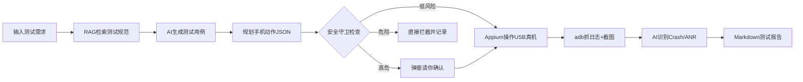
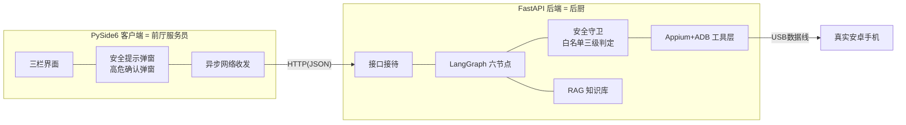
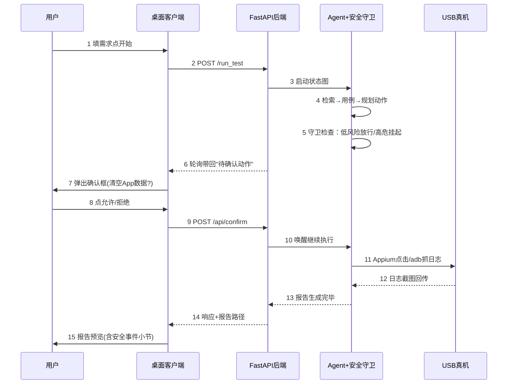
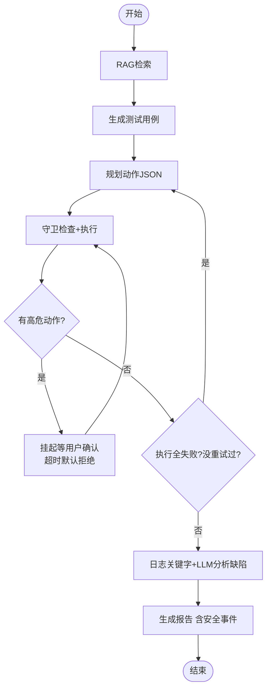
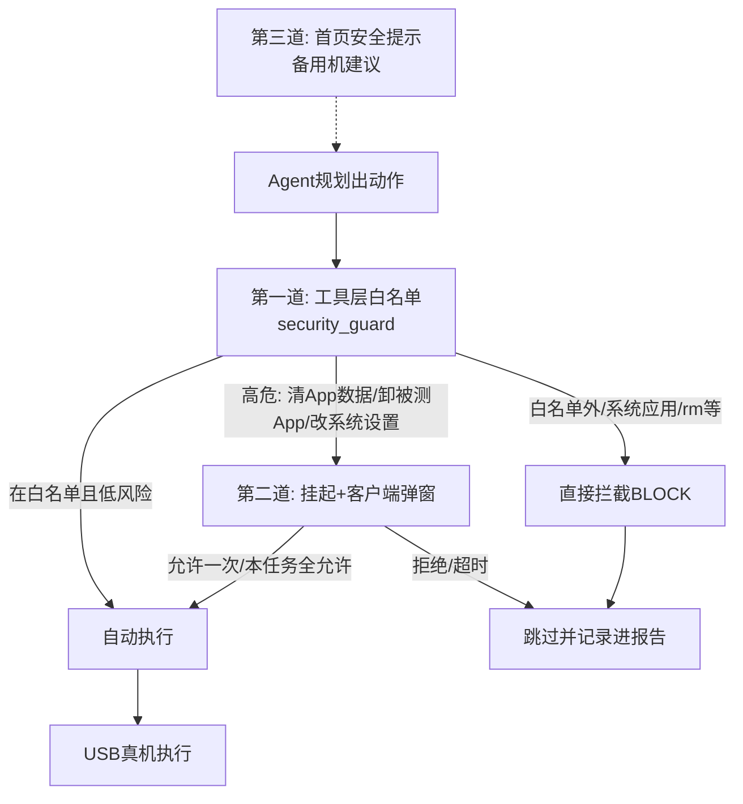

# 产物2：从零学会 AI Agent 开发——USB真机安卓测试Agent实战教学（含安全专题）

> **序言：知识主动分享**
> 这份教程来自一个真实可运行的毕业设计项目：用 USB 数据线连上你的安卓手机，AI Agent 自动完成 App 测试并生成报告。我们把整个工程拆开、揉碎，用大白话讲清楚每一层为什么这么设计——包括很多人回避的**真机安全**问题：真手机不是玩具，我们如何用"白名单+人工确认"守住底线。欢迎转发分享，用实战案例学习才是最快的路。

---

# 第一章：课程介绍 & 项目简介

## 1.1 什么是 AI Agent？——招个"实习生"

**Agent = 大模型大脑 + 工具双手 + 工作流程 SOP。**

普通大模型调用像"打电话问专家"：问一句答一句。Agent 像招了个实习生：你说"测一下这个 App"，他自己查资料（RAG）、写计划（生成用例）、动手干活（Appium 点手机）、盯结果（看日志）、交报告。**区别就一句话：普通调用只出主意，Agent 还能动手把事办完。**

## 1.2 项目是做什么的？USB 真机测试的痛点

安卓 App 测试费人费力：写用例、装手机上一个个点、翻几百行日志找崩溃、手工写报告。

本项目的完整流程：



**注意 E 那一步**——这是本教程独有的章节：操作的是**真实手机**，不是沙箱里的模拟器，所以每个动作都要过一道"安检门"。第七章专讲。

## 1.3 为什么选这个项目做教学案例？

一个项目串起企业 AI 应用的全部环节：大模型双切换、RAG 知识库、工具调用、流程编排（LangGraph）、原生桌面 GUI（PySide6）、打包发布（PyInstaller）——外加其他教程很少讲的**安全工程**（真机风险控制、密钥内存管理、操作白名单）。学完把"手机测试"换成"运维巡检"，架构思路原样复用。

## 1.4 整体技术栈一览

| 技术 | 是干嘛的 | 项目里的角色 | 为什么选它 |
|---|---|---|---|
| Python | AI 生态最全的胶水语言 | 全项目语言 | 库多、上手快 |
| FastAPI | 把函数变成网络接口的框架 | 后端接待窗口 | 自带参数校验+接口文档 |
| LangGraph | 把多步骤任务画成流程图 | Agent 的 SOP | 支持分支重试，失败自动重规划 |
| LangChain | 大模型万能转接头 | 统一接入千问/DeepSeek | 换模型不改业务代码 |
| Chroma | 会"按意思搜索"的本地库 | 测试知识库 | pip 即用，零部署 |
| Embedding | 文字→数字坐标 | 语义相似度计算 | 本地免费不联网 |
| Appium | 手机自动化机械手 | 模拟点击输入 | 真机/模拟器通用，行业标准 |
| ADB | 电脑↔手机对讲机 | 抓日志、截屏、设备检测 | 安卓官方工具 |
| PySide6 | Python 桌面 GUI 官方库 | 整个界面 | Qt 原生控件，禁用 WebView |
| PyInstaller | 打包成 exe | 交付 | 对方电脑免装 Python |

## 1.5 企业级开发 vs 网上 Demo（核心区别）

| 维度 | 玩具 Demo | 本项目 |
|---|---|---|
| 文件组织 | 一个 py 五百行 | 按职责分层分文件夹 |
| 换大模型 | 全文搜索改代码 | 改一行 .env |
| 出错 | 白屏崩溃 | 分类捕获+人话提示 |
| 安全 | 从不考虑 | 白名单+确认弹窗+密钥不落盘 |
| 交付 | "先装下 Python" | 双击 exe |

**核心思想：每块代码只干一件事，块间用明确接口对话。** 本章之后这句话会出现十次。

---

# 第二章：系统整体架构通俗讲解（C/S 架构）

## 2.1 架构图：餐厅的后厨与前厅



**分工铁律**：客户端只做"收集配置、展示日志、转发你的确认意见"；后端做所有"动脑+动手"，**安全判断全部在服务端**——客户端弹窗只是把你的选择转告后端。为什么？前端永远可能被绕过（改内存、抓包重放），后端才是唯一可信的执法者。

## 2.2 为什么拆分前后端？全写一起的四大灾难

1. **界面卡死**：Agent 跑几分钟，期间窗口全部"未响应"（原因见 5.5）；
2. **改 A 坏 B**：界面代码和测试逻辑搅在一起，改日志颜色可能弄崩手机操作；
3. **安全难做**：安全检查埋在界面代码里，换个入口（网页/脚本）就绕过了；
4. **无法复用**：想加网页版？逻辑长在界面里拔不出来。

分层后：前端崩了任务继续跑；加网页入口后端零改动（本项目真有一个 index.html）；安全守卫独立成模块，**谁调用工具都绕不过它**。

## 2.3 完整数据流转链路



第 6-10 步就是"高危操作二次确认"的完整回路：**后端挂起等决定 → 客户端轮询发现 → 弹窗问你 → 你投票 → 后端继续**。全程不需要 WebSocket，复用每秒一次的轮询通道。

---

# 第三章：项目目录 & 所有文件逐份讲解（核心章节）

```
test_agent/
├── main.py                # 后端总开关
├── requirements.txt       # 依赖采购清单
├── .env / .env.example    # 私密账本 / 给别人看的模板
├── .gitignore             # 密钥、模型、产物不上传
├── config/settings.py     # ★ 配置中心（含动作白名单/高危分级表）
├── utils/                 # 公共工具箱
│   ├── logger.py          # 统一日志
│   ├── log_buffer.py      # 环形日志缓冲（客户端拉取的数据源）
│   └── resource_path.py   # 打包后找文件的救星
├── rag/                   # 知识库
│   ├── document_loader.py # 读文档+切片
│   └── vector_store.py    # Chroma 仓库（单例）
├── tools/                 # Agent 的"手"
│   ├── appium_tool.py     # 操作真机（try-finally 保护会话）
│   ├── adb_tool.py        # 固定函数集：抓日志/截屏/查设备
│   ├── security_guard.py  # ★★ 安全守卫：AUTO/CONFIRM/BLOCK 三级判定
│   └── report_tool.py     # Markdown 报告（含安全事件小节）
├── agent/                 # Agent 的大脑流程
│   ├── state.py           # 工作交接单（含安全事件字段）
│   ├── nodes.py           # 6 个工位（执行前必过守卫）
│   └── graph.py           # 流水线装配+失败重试
├── api/server.py          # 全部接口 ★ 含确认队列接口
├── templates/index.html   # 网页版入口（含安全声明）
├── desktop/               # 桌面客户端（独立小工程）
│   ├── core/              # 底层：配置(密钥仅内存)/日志桥/图标
│   ├── net/               # 网络：异步请求/接口封装/轮询线程
│   └── ui/                # 界面：三栏主窗口/日志面板/配置面板
│       ├── dialogs.py     # 报告预览（原生渲染，非WebView）
│       ├── security_dialog.py  # ★ 高危操作确认弹窗
│       └── welcome_dialog.py   # ★ 首页安全提示（备用机建议）
├── packaging/             # 一键启动脚本+使用说明（含真机安全须知）
├── docs/                  # 文档
└── outputs/ dist/         # 运行产物 / 打包产物（不进git）
```

**重点文件深讲**：

- **config/settings.py**：所有配置集中+自动读 .env。小白重点：`ANDROID_CAP` 是个 @property 动态属性——选真机就注入 `appium:udid`（手机身份证号），选模拟器就填设备名。**动作白名单也在这里**：安全策略是"配置"不是"代码"，调整不用改程序。
- **tools/security_guard.py（本项目灵魂文件）**：每个动作先问它——点击输入？放行（AUTO）。清空被测App数据？挂起等人（CONFIRM）。删系统文件、卸系统应用？拦下（BLOCK）。**为什么单独建文件**：闸门独立才能"任何调用方都绕不过"，也才能单独写测试。小白重点：三级判定的判断代码，和那张分级表。
- **tools/adb_tool.py 的"故意缺失"**：它**没有**"执行任意 adb 命令"的函数！只有抓日志、截屏等固定函数。这是接口级安全设计——Agent 的世界里根本没有"原始命令"这个东西，想注入都无从下手。
- **agent/state.py**：注意里面有三个"安全字段"：blocked_actions（拦了什么）、pending_confirmations（在等谁确认）、confirmed_action_ids（你批过什么）。安全事件是一等公民，最后全部写进报告——**可追溯是安全的证据链**。
- **desktop/ui/welcome_dialog.py**：软件第一次打开弹的"安全告知"：请用备用测试机、勿用存隐私的主力机、测试可能清空应用数据。勾选"我已知晓"才能用。**为什么**：真机有真实风险，提前告知既是教育也是免责，这是产品化的基本素养。
- **desktop/ui/security_dialog.py**：高危动作弹窗，三个按钮【允许一次】【本任务全部允许】【拒绝】。为什么三个？只有"允许"会逼出弹窗疲劳（用户养成无脑点允许的坏习惯），"全部允许"服务"反复清数据重测"的真实工作流，"拒绝"保底。

**目录分层理由**：依赖严格单向 `api→agent→tools→config/utils`、客户端 `ui→net→core`。守卫放 tools 层不在 agent 层——因为"水龙头"在工具执行处，闸门装在水龙头上，任何管道都跑不出它的管辖。

---

# 第四章：接口设计讲解（小白友好）

## 4.1 什么是 API 接口？

**点菜窗口**：客户端递单子（请求：地址+方法+参数），窗口回东西（响应 JSON）。`127.0.0.1:8000` = 本机自己的 8000 号窗口。

## 4.2 后端接口清单

| 接口 | 方法 | 作用 | 入参 | 返回 |
|---|---|---|---|---|
| /health | GET | 活着吗 | 无 | ok |
| /upload_doc | POST | 上传知识文档 | txt文件 | 切片数 |
| /run_test | POST | 启动测试任务 | requirement + 可选：模型provider/两个API密钥/真机开关/UDID | 报告路径+缺陷+安全事件 |
| /api/config | GET | 当前配置 | 无 | 模型/设备/UDID后4位 |
| /api/logs | GET | 增量日志 | after_seq（看到第几条了） | 新日志+最新序号 |
| /rebuild_kb | POST | 重建向量库 | 无 | 片段数 |
| **/api/pending_confirmations** | GET | ★ 有没有等你拍板的危险动作 | task_id | 待确认动作列表（含影响说明） |
| **/api/confirm/{id}** | POST | ★ 你对高危动作的裁决 | approved（允/拒）+ remember | 处理结果 |

注意：密钥是**可选**入参，前端填了就临时用（仅内存），不填回退 .env——两种方式兼容，方便演示。

## 4.3 Qt 怎么调接口？轮询是什么？

客户端用 QNetworkAccessManager 发请求：**发出后不等，结果到了用"信号"通知界面**——期间窗口照样能拖能点。

**轮询**：像刷物流页面。客户端有个专职线程（QThread）每秒问后端一次"有什么新东西？"，一次带回两类数据：新日志 + **有没有待确认的危险动作**。`after_seq` 参数是"我上次看到第几条"，后端只给新的，不重复不遗漏。

**为什么不用 WebSocket 推送**：轮询实现简单、打包稳、1 秒延迟演示无感。企业里两种都常用——**选型看场景，不追时髦**。

## 4.4 企业接口设计规范

1. 命名见名知义（/run_test）；2. Pydantic 校验前置（需求文本必须 5~2000 字，垃圾进不来）；3. 错误说人话（"需求描述至少5个字符"，不甩英文堆栈）；4. **安全接口要防重放/越权**：确认接口校验 action_id 属于当前任务、重复确认幂等处理。

---

# 第五章：核心模块分步讲解（由浅入深）

## 5.1 FastAPI 后端基础

```python
class RunTestRequest(BaseModel):
    requirement: str = Field(..., min_length=5, max_length=2000)
    qwen_api_key: Optional[str] = None   # 可不填，填了仅内存使用
```

Pydantic 模型是"单子上的规矩"，不合格自动拒绝，代码一行判断不用写。长任务（几分钟）本项目用"同步执行+轮询补实时性"；更大规模才上 Celery 队列——**原型阶段不引入重装备，够用就好，这本身是工程判断**。

## 5.2 LangGraph Agent：会自己拐弯的流程图

三个概念：**State**=全流程共享的交接单；**Node**=一个工位；**Edge**=流转路线（含条件边）。



**"工具调用"通俗版**：大模型不摸手机！它只输出"操作清单"JSON（点击哪个按钮、输入什么字），由**确定的代码**执行——而且执行前必须过安全守卫。**大脑出主意，双手按章程办事，保安守大门**。为什么不让大模型直接操作？它会幻觉（胡来），清单可审查可归档，守卫可拦截——三层各司其职。

## 5.3 RAG：给大模型开卷考试

大模型不懂"你们公司的测试规范"，硬问就瞎编（**幻觉**）。RAG 四步：**切**（文档切 500 字片段）→**化**（每片段变成语义坐标）→**存**（Chroma）→**查**（需求也变成坐标，取最近的 top3 塞进提示词）。回答被"锚定"在真实资料上，幻觉大幅下降。

本项目小彩蛋：知识库里放了一份**《真机测试安全规范》**（写明哪些操作要人工确认）——LLM 规划动作时自带安全意识，和代码守卫形成双保险。

## 5.4 Appium+ADB：重点区分模拟器与 USB 真机

| 维度 | 安卓模拟器 | USB 真实手机 |
|---|---|---|
| 隔离性 | **自带沙箱**，崩了重置 | **没有任何设备沙箱** |
| 数据风险 | 随便折腾 | ADB 可改 App 数据、可卸载应用 |
| 连接参数 | 设备名 emulator-5554 | `appium:udid` = 手机身份证号 |
| 常见坑 | 启动慢 | 息屏失效、厂商ROM权限、USB授权弹窗、中途拔线 |

**ADB 原理**：电脑和手机之间基于 USB 的命令通道，能抓日志（logcat）、截屏、查设备。**真机安全关键点**：adb 权限很大，`pm clear` 一条命令就能清空某 App 全部数据——这正是本项目要装"守卫"的原因。

**Appium 原理**：告诉它"点击 resource_id 为 xxx 的按钮"，它模拟手指。**会话（Session）= 接管手机的租约，用完必须还（quit）**——本项目用 try-finally 保证。真机会话泄漏 = 用户的手机被占住，比模拟器严重得多。

**Crash 捕获双保险**：先关键字扫描（FATAL/Crash/ANR，只看警告以上级别防误报），再把真实证据行交给大模型语义分析；大模型挂了关键字兜底。**不撒谎的关键字 + 看得懂上下文的 LLM，各取所长。**

## 5.5 PySide6：为什么不能在 UI 主线程干重活？（本章最重要）

Qt 界面靠主线程的"事件循环"活着：不停处理点击、刷新画面。**在按钮响应里直接发一个 3 分钟的请求 = 事件循环被卡 3 分钟 = 界面假死**。

> 比喻：餐厅只有一个服务员（主线程）。他跑去后厨盯着炒菜 3 分钟，大厅客人全没人管。**点餐的不能炒菜——重活派给后厨（子线程），干完用广播（信号槽）喊一声。**

本项目三条纪律：
1. 发请求用 QNAM 异步，结果到了信号通知；
2. 持续轮询开 QThread 专职线程；
3. **子线程不许直接碰界面**——通过信号把数据寄回主线程处理（Qt 保证信号处理永远在主线程，天然线程安全）。

高危确认弹窗尤其如此：轮询线程收到"待确认事件"→ emit 信号 → **主线程**收到信号才弹窗。模态框跨线程必崩，这是铁律。

---

# 第六章：从零搭建项目，小白学习顺序

### 第 1 步：环境与依赖
- 做：Python 3.10+、虚拟环境、pip 装依赖。
- 验证：import 全家桶不报错。
- 为什么：地基；后面每步验证都靠"能跑"。
- 坑：Python 版本老；国内换 pip 清华源。

### 第 2 步：FastAPI 骨架
- 做：main.py + /health，浏览器玩 Swagger 文档页。
- 验证：访问 /health 返回 ok。
- 坑：端口被占；改代码忘重启。

### 第 3 步：真机控制 Demo（先手动跑通 adb！）
- 做：手机开开发者模式+USB调试 → `adb devices` 看到设备并授权 → 装 Node+Appium → 写 appium_tool 连真机点一下计算器。
- 验证：**你的真机**被程序点开 App。
- 为什么：真机环境变量多，先手工跑通 adb 链路，把环境问题和代码问题分开。
- 坑：小米/OPPO 需额外开"USB调试（安全设置）"否则点不动；会话忘 quit 手机被占死。

### 第 4 步：RAG 模块
- 做：document_loader + vector_store，传一篇测试规范测检索。
- 验证：查"卸载应用怎么测"命中对应片段。
- 坑：忘做单例，每次查询等 10 秒。

### 第 5 步：安全守卫（先于 Agent！）
- 做：security_guard 三级判定 + **先写单元测试**（白名单内→AUTO、pm clear→CONFIRM、rm 系统文件→BLOCK）。
- 验证：测试全绿。
- 为什么：先有闸门再放水；测试就是分级表的"法律"。

### 第 6 步：LangGraph Agent 串联
- 做：state（含安全字段）→ nodes 六工位（执行前过守卫、高危挂起）→ graph（装配+失败重试）。
- 验证：命令行跑全流程，构造危险动作确认被拦/被挂起。
- 坑：LLM 输出不是纯 JSON——剥离代码块+正则提取+带错误重试 1 次三板斧。

### 第 7 步：后端任务管理与确认队列
- 做：/run_test 完整版、/api/logs、**/api/pending_confirmations + /api/confirm**、Pydantic 友好错误。
- 验证：Swagger 手工模拟"发现待确认→拒绝→动作跳过→报告记录"。

### 第 8 步：PySide6 客户端
- 做：三栏窗口→彩色日志→轮询线程→**welcome 安全提示+确认弹窗**→报告预览（QTextDocument.setMarkdown 原生渲染）。
- 验证：点按钮→日志滚动→弹窗出现→拒绝后动作跳过，全程界面不卡。
- 坑：主线程发同步请求=卡死；弹窗必须在主线程弹。

### 第 9 步：联调与安全测试
- 做：真机全流程演练 + 红队自查（诱导 LLM 输出卸载系统应用→验证被拦；中途拔 USB→验证优雅处理；确认接口越权→验证被拒）。
- 为什么：安全机制没被攻击过=没测过；这组用例也是答辩最亮的素材。
- 坑：拔线后 adb 命令会挂死——所有 subprocess 必须 timeout。

### 第 10 步：PyInstaller 打包
- 做：后端 onedir+console、客户端 onedir+windowed+自绘图标；配 hidden-import/资源路径。
- 验证：无 Python 的电脑双击能跑。
- 限制讲清楚：**Appium、ADB、USB 驱动都打不进 exe**——它们是外部环境，分发包配一键启动脚本+使用说明。
- 坑：打包后路径全变（用 resource_path）；uvicorn 要传 app 对象；动态 import 库要补 hidden-import。

---

# 第七章：项目安全专题（⭐ 重点：沙箱与真机风险）

## 7.1 沙箱（Sandbox）是什么？——"隔离病房"比喻

**沙箱 = 一个出不去的围栏**。把不可信的程序放进去随便折腾，出事只烂在围栏里，伤不到外面世界。

关键认知：**沙箱是安全兜底，不是幻觉解药**。大模型幻觉（输出错误内容）要靠 RAG、白名单、人工确认来治；沙箱只负责"万一它真干坏事了，损失被圈住"。别指望一个沙箱解决所有安全问题。

## 7.2 沙箱常见实现对比

| 方案 | 原理 | 优点 | 缺点 | 适用 |
|---|---|---|---|---|
| Docker 容器沙箱 | 容器隔离文件系统/网络 | 隔离强、可销毁重建 | Windows 上要装 Docker Desktop（重）；GUI/USB 设备穿透麻烦 | 服务端跑不可信代码 |
| 云端沙箱 | 危险操作丢给云上一次性虚拟机 | 本机零风险 | 要联网花钱、有延迟、数据出本机 | 企业级 SaaS |
| 轻量进程沙箱 | 独立进程+低权限用户+受限目录 | 轻量 | 隔离弱，需精心配置 | 风险较低场景 |

## 7.3 本项目 V1 为什么不需要主机侧代码沙箱？

**因为 V1 根本不开放"动态执行代码"这个能力。** Agent 只能调用预先封装好的工具函数（点击/输入/抓日志），没有任何"执行任意 Python/Shell"的入口——**没有危险操作，就不需要围住危险操作的笼子**。Windows 主机上跑的只是"调接口、操作手机"的普通程序，它本身不需要沙箱。

> 【为什么这么做】沙箱是给"放开了能力"的系统兜底的。V1 选择**收窄能力**（白名单工具）来换掉整个 Docker 基础设施——打包分发还是一个文件夹，毕设答辩无需带 Docker 环境。这是明确的工程取舍：**用产品约束替代基础设施**。V2 若开放 Agent 自写测试脚本并执行（能力大增），那时才必须上 Docker 沙箱（见 7.6）。

## 7.4 ⭐ USB 真机测试：最大的安全差异——没有设备沙箱

**模拟器 = 沙箱里的手机**：崩了重置、数据随便清、本来就没有隐私。

**USB 真机 = 你兜里的手机**：
1. **没有隔离**：adb 拿到的权限足以读写被测 App 数据（`pm clear` 一条命令清空应用全部数据，包括登录状态和本地记录）、卸载应用、改系统设置；
2. **风险真实**：清错包、误删数据、甚至卸载系统应用导致设备异常，都发生在**你的真手机**上；
3. **LLM 加持放大风险**：Agent 会自主规划动作，一旦幻觉输出危险指令且无人把关，后果直达真机。

所以本项目把真机安全做成三层（而不是依赖任何沙箱）。

## 7.5 本项目的安全防护方案（业务层三道防线）



**第一道：工具层白名单（代码级硬拦截）**
- 三级判定：AUTO（点击/输入/滑动/抓日志）/ CONFIRM（pm clear 被测包、卸载被测包、settings put）/ BLOCK（白名单外一切、卸载系统应用、rm 任何路径、reboot）；
- adb_tool 只暴露固定函数，**不提供任意命令透传**——接口级消灭注入。

**第二道：高危动作人工确认（弹窗）**
- 后端挂起 → 客户端轮询发现 → 弹窗展示动作与影响 → 你裁决 → 后端继续；
- 三个按钮：允许一次 / 本任务全部允许 / 拒绝；120 秒超时默认拒绝；
- **为什么弹窗不是提示词**：提示词只是"劝"大模型，输出不可信；弹窗是问**人**——真机上的数据属于用户，只有用户有权决定清不清。

**第三道：首页安全提示（教育+免责）**
- 首次启动强制弹窗："推荐专用备用测试机，请勿使用保存个人隐私的主力手机；测试可能清空被测App数据"，勾选知晓才能用；
- **为什么这条很重要**：技术防线再好，也挡不住"用户拿存了银行卡的主力机来测"——风险告知是最后一层人格防线，也是软件产品的责任边界。

## 7.6 V2 扩展方向：动态脚本执行才需要 Docker 沙箱

如果 V2 开放"Agent 自己写测试脚本并执行"（能力质的飞跃），情况彻底变化：执行的是**运行时生成的不可信代码**，白名单无从谈起——此时必须引入 **Docker 容器沙箱**（一次性容器、只挂载测试目录、限网限时、执行完销毁），手机连接也改由宿主机代理转发进容器。一句话记住演进逻辑：

> **能力开放到哪里，沙箱就要修到哪里；V1 用白名单守住能力边界，V2 用容器守住执行边界。**

---

# 第八章：项目测试、异常处理与打包

## 8.1 单元测试：烟雾报警器

企业写测试的原因：改代码时跑一遍，立刻知道有没有改坏别处——**人肉回归不现实，机器回归才是企业做法**。本项目两个代表：security_guard 的分级判定测试（安全承诺的法律）；GUI 离屏烟雾测试（`QT_QPA_PLATFORM=offscreen`，无显示器也能自动化验证界面逻辑）。

## 8.2 常见异常与说人话处理

| 异常 | 程序行为 | 用户看到 |
|---|---|---|
| LLM API 失败/密钥错 | 捕获写进状态 | "大模型调用异常，请检查 Key" |
| Appium 连接失败 | 会话异常细分捕获 | "请检查 Appium 与 USB 连接" |
| **真机中途拔线** | adb timeout 兜底 | 任务失败但报告仍生成（记录中断点） |
| 向量库失败 | RAG 降级为空上下文 | 任务继续 |
| **确认超时** | 默认按拒绝 | 报告记录"超时未确认" |

两条原则：**每层捕获自己该管的异常**（工具层管设备、节点层管流程、接口层兜底）；**降级优于崩溃**（能力可以打折，服务不能直接死）。所有异常日志带完整 traceback。

## 8.3 PyInstaller 打包

原理：把 Python 解释器+依赖+代码整体复制进文件夹，配启动器。关键参数：onedir（目录模式，启动快误报低）、--add-data 打包模板、--hidden-import 补动态导入、--copy-metadata 补包元数据。

**打不进去的**：Appium（Node.js 程序）、ADB、USB 驱动、安卓手机——都是外部环境。所以分发包配 start_all.bat（含 adb devices 真机自检）和带安全须知的使用说明。

---

# 第九章：扩展学习 & 进阶方向 + 课后练习

## 9.1 可扩展功能

多设备并行测试、用例智能修复（截图喂多模态模型重新定位）、性能指标采集（CPU/内存曲线入报告）、历史缺陷知识库、任务队列、**V2：Agent 自写脚本 + Docker 沙箱执行**。

## 9.2 架构迁移公式

> **换行业 = 换知识库内容 + 换工具层 + 改提示词，Agent 骨架与前后端全部复用。**

| 场景 | 知识库 | 工具层 | 干什么 |
|---|---|---|---|
| 运维巡检 Agent | 运维手册SOP | SSH执行/监控API | 生成巡检项→执行→报告 |
| 办公文档 Agent | 公文规范 | Word/PDF解析 | 起草→自查→成稿 |
| 数据报表 Agent | 指标口径 | SQL执行(白名单!) | 理解需求→查询→制图 |

注意运维/数据场景的"工具白名单"思想完全通用——**凡是能改真实世界的 Agent，都需要分级守卫**。

## 9.3 课后练习（由易到难）

1. 报告增加"测试耗时统计"小节；
2. /run_test 增加被测 App 包名可选参数（仿 real_udid 透传链路）；
3. 给 security_guard 新增一个你想到的 CONFIRM 级动作并补测试；
4. 确认弹窗增加"倒计时 30 秒自动拒绝"的 UI 显示；
5. 按迁移公式把项目改造成"文件整理 Agent"（扫描→AI建议归类→白名单内移动文件→报告），体会守卫如何迁移。

---

# 第十章：常见疑问 FAQ

**Q1：Agent 和普通大模型调用的差别？**
普通调用出主意，Agent 还动手：大脑（LLM）+双手（Appium/ADB）+SOP（LangGraph）+保安（安全守卫）。本项目里大模型只"想"，"做"的永远是有白名单把关的封装工具。

**Q2：为什么不把所有代码写在一个文件？**
能跑但活不长：改 A 坏 B、排错翻千行、没法协作、没法复用、**安全检查会被绕过**。判断标准：在文件里找"这段干嘛的"超过 3 次，就该拆了。

**Q3：为什么用 LangGraph，直接写 Python 循环行不行？**
小任务行。但"失败重试+重试上限+高危挂起等确认"用循环写很快变嵌套地狱且流程不可见。LangGraph 把流程变成显式的图：节点=函数、重试=条件边、挂起=状态字段。不是它有魔法，是它逼你把流程想清楚再写。

**Q4：什么是线程阻塞？GUI 卡死的原因？**
主线程被一件事绊住，手上其他活全停。Qt 界面靠主线程不停刷新才活着，3 分钟请求 = 3 分钟假死。解法：重活子线程，结果用信号槽寄回主线程。

**Q5：RAG 必须用 Chroma 吗？**
不必。Chroma 零配置适合原型；FAISS 更快、Milvus 企业级。本项目把检索封装在 vector_store.py 一个文件里，换库只改一处——**封装才是可替换的保证**。

**Q6：沙箱是 LangGraph 自带的组件吗？**
不是。LangGraph 只管流程编排，没有沙箱概念。沙箱是独立的隔离技术（Docker/虚拟机/进程隔离），要不要用取决于你开放了什么能力——本项目 V1 用白名单收窄能力，所以主机侧不需要沙箱；但真机侧风险用"业务层三道防线"补上了。

**Q7：真机 USB 测试相比模拟器，安全上最大的区别是什么？**
一句话：**模拟器自带隔离沙箱，真机没有任何设备侧沙箱**。模拟器崩了重置就行；真机上 adb 能清数据、卸应用，错误直达你的手机。所以本项目把白名单、人工确认、备用机建议当成和功能同等重要的设计，而不是事后补丁。

**Q8：高危动作弹窗会不会很烦？**
设计上刻意平衡：低风险动作全自动（弹窗疲劳是安全 UX 的敌人）；只有真高危才弹；提供"本任务全部允许"给"反复清数据重测"的真实工作流；所有裁决记录进报告。安全要让用户知情可控，而不是烦到关掉防护。

---

> **结语**：这个项目最值得带走的不是某个 API 用法，而是三个习惯：**分层**（每块代码只干一件事）、**收窄**（能力边界就是风险边界）、**兜底**（代码拦得住的用代码拦，代码拦不住的问人，人也可能不在线就默认拒绝）。带着这三个习惯，你去搭任何行业的 Agent 都不会跑偏。祝你早日造出自己的 Agent。
